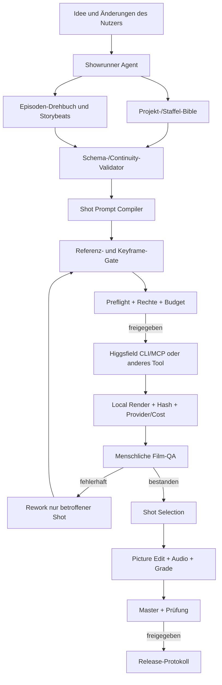

# 00 — Architektur und Datenfluss

## Komponenten

Das Repo ist bewusst **kein monolithischer „Text rein, Film raus“-Service**. Die Produktionsintelligenz sitzt in einem externen Coding-Agenten; SHOTLOOM liefert stabile Verträge, maschinenlesbare Daten, QA-Gates und lokale Montage. So kann später ein anderer KI-Chat oder ein anderer Videoanbieter übernehmen, ohne dass Cast, Story und Cut-Logik verloren gehen.

## Single source of truth

`project.yaml` = Projektvertrag und genehmigte visuelle/akustische Welt. `episodes/EPxx.yaml` = aktuelle Szenen- und Shotversion. `rights/assets.csv` = Quellen-/Nutzungsnachweise. `state.json` = Ausführungs- und Reviewjournal (lokal und gitignored); `compiled/EPxx` = daraus abgeleitete Prompts/Jobs/Timeline (neu generierbar). `renders/` = echte Medien. `output/` = abgeleitete Master/Releaseprotokolle. Originale/Medien gehören in einen geeigneten sicheren Speicher, nicht in den Git-Verlauf.

## Versions- und Fehlerverhalten

Die Quellvertrags-Prüfsumme erfasst `project.creative/characters/locations/props/delivery` plus Episode. Bei Änderungen werden alte Render auf Vertragsabweichung geprüft und nicht mehr als aktuelle Selektion verarbeitet. Der heutige Prototyp sperrt dann sicherheitshalber die gesamte Episode. Später soll ein Dependency-Graph nur direkt abhängige Shots invalidieren.

Fehlschlagtypen strikt unterscheiden: **structural validation** (fehlende IDs/Zeiten), **preflight** (Referenz/Rechte/Budget), **provider job** (Providerfehler/Timeout), **media file** (korrupt/zu kurz), **aesthetic QA** (Identität/Physik/Performance), **editorial QA** (Schnitt/Ton/Story) und **release** (Finalabnahme). Der jeweils richtige Fehler soll nur an der kleinsten betroffenen Stelle korrigiert werden.

## Kontrollgrenzen

Der Agent darf den Text produzieren, Assets empfehlen und strukturierte Jobs vorbereiten. Ein echter kostenpflichtiger Call braucht explizite Zustimmung; Rights-Flag und `--confirmed` sind ohne vertrauenswürdige Rechteverwaltung keine serverseitige Sicherheitsbarriere. Der Editor darf nur tatsächlich vorhandene, ausgewählte und überprüfbare Dateien montieren. Finalrelease bleibt eine bewusste menschliche Entscheidung.
